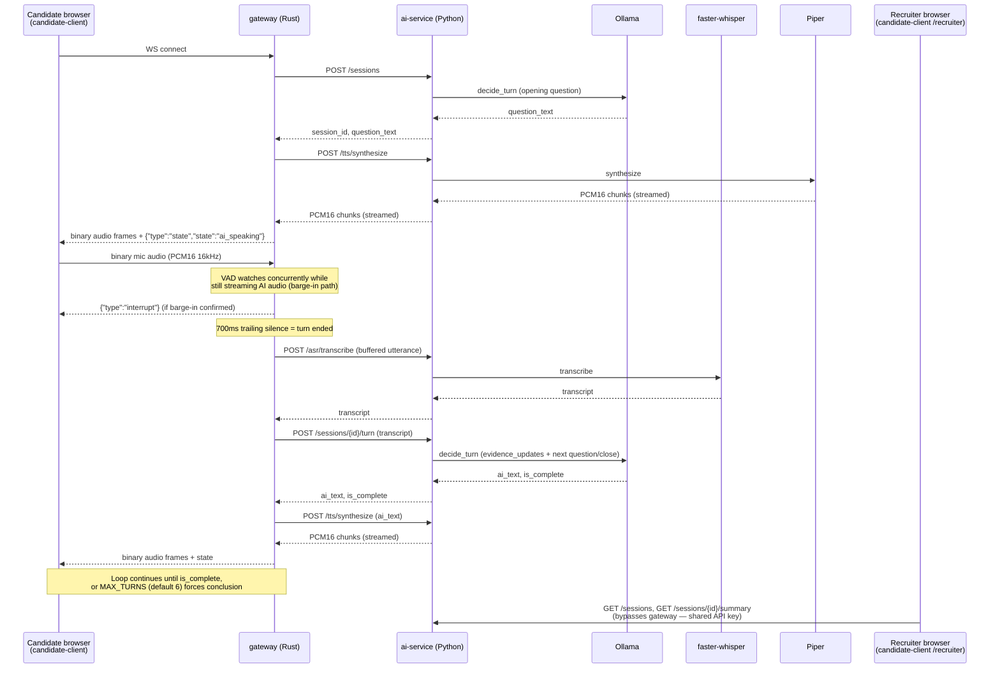
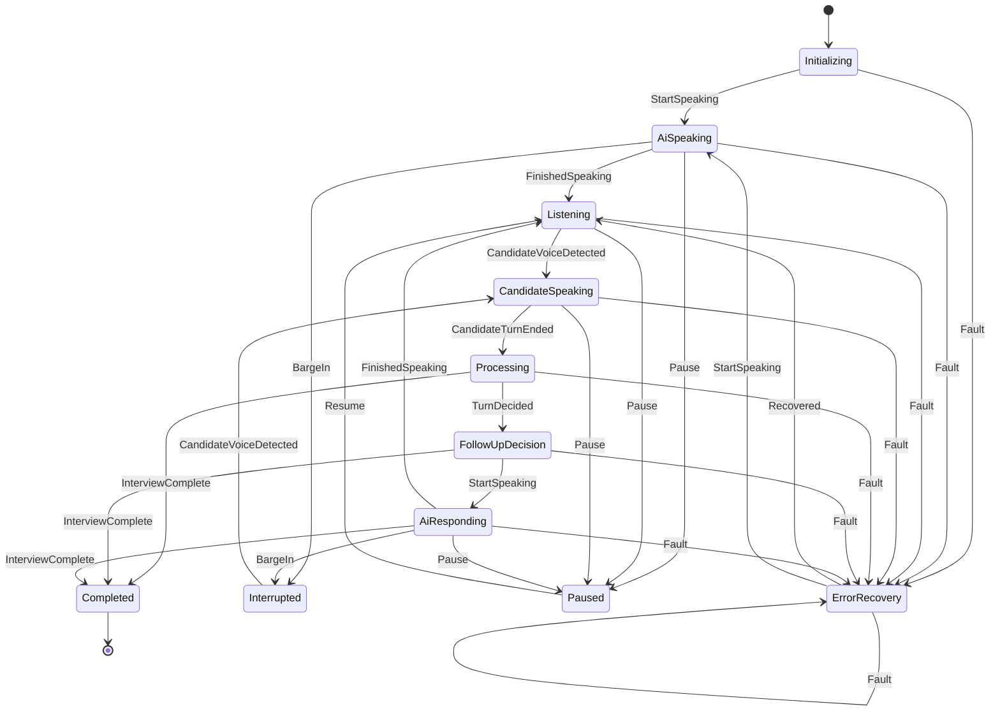

# Architecture

PyInterviewBot is a voice-first AI interview platform: the candidate hears
questions, answers by voice, and never sees a transcript, score, or any
part of the evaluation. Everything — ASR, evidence extraction, the
competency graph, adaptive follow-ups — happens silently server-side.

This document describes what's actually implemented in this slice, how the
three languages divide responsibility, and exactly where the implementation
simplifies the full product spec (and why).

> **2026-10-25 update:** the Python service now has provider-neutral ASR/TTS/LLM
> contracts with `local` and `mock` implementations; a self-hosted Rust voice
> runtime crate; a versioned interview-template engine; evidence-linked reports
> with human review; and bounded audio/transport controls. See the sections at the end of
> this document and `docs/internal/BASELINE_AUDIT.md`.
>
> **2026-10-26 update:** the Rust gateway now owns a dedicated canonical call-state
> SQLite database and lifecycle API. Python remains the interview system of record
> and must not write call state directly. Twilio status/inbound/outbound and
> Vapi-compatible managed-call webhooks are mapped into that store. See
> [`docs/CALL_STATE.md`](CALL_STATE.md) and
> [`docs/adr/0005-rust-owned-call-state.md`](adr/0005-rust-owned-call-state.md).
>
> **2026-10-28 workflow update:** ai-service exposes a user-owned workflow
> artifact lifecycle: immutable content-hashed versions, a fixed mock sandbox,
> mandatory deterministic suites, separated approval, exact-hash production
> promotion, deployment failure history, and binding-aware rollback. New direct
> and channel sessions may optionally supply `workflow_id`; routing pins the
> active production deployment and its template snapshot on the session, and
> all session-scoped template lookups use that pin. Omitting `workflow_id`
> preserves the legacy `template_id` path. See
> [`docs/WORKFLOWS.md`](WORKFLOWS.md).

## Layers

```
Browser (candidate-client, Vite/TS)
   │  WebSocket — binary: mic audio (candidate → server) / TTS audio (server → candidate)
   │             text (JSON): {"type":"state",...} | {"type":"interrupt"} | {"type":"error",...}
   │  There is no message type for a transcript, score, or evidence — the
   │  protocol itself cannot leak that to the candidate client, independent
   │  of what the UI chooses to render.
   ↓
gateway/ (Rust, axum)
   - Deterministic session state machine (gateway/src/state_machine.rs):
     Initializing → AiSpeaking ⇄ Interrupted → Listening ⇄ CandidateSpeaking
     → Processing → FollowUpDecision → AiResponding → … → Completed /
     ErrorRecovery. Pure function, fully unit tested (19 tests), no IO.
   - VAD + end-of-turn heuristic (gateway/src/vad.rs): wraps `earshot`
     (pure-Rust neural VAD). 200ms of confirmed voice = "speech started"
     (drives barge-in); 700ms of trailing silence after speech = "turn
     ended". A ~300ms preroll ring buffer means the moment speech is
     confirmed, the audio leading up to it is retroactively included —
     the first syllable isn't clipped.
   - Barge-in: while AI audio is streaming out, incoming mic audio is
     watched concurrently (`tokio::select!`). The moment VAD confirms real
     speech, the TTS stream is dropped (Piper synthesis is cancelled
     server-side too, since it's a cancelled HTTP request) and an
     `{"type":"interrupt"}` message tells the browser to stop playback
     immediately.
   - Playback-duration awareness: Piper synthesizes faster than real time,
     so "all TTS bytes have been sent" happens well before "the candidate
     has finished hearing the question." `speak()` tracks total audio
     bytes sent and won't return `Finished` (or stop watching for a
     barge-in) until that much playback time has actually elapsed.
   - Owns only transport/turn-taking state. Domain data (evidence,
     transcript, claims) is not duplicated here — ai-service is the single
     source of truth, avoiding a two-database sync problem.
   ↓ HTTP (POST /sessions, /sessions/{id}/turn, /asr/transcribe, /tts/synthesize)
ai-service/ (Python, FastAPI, uv-managed)
   - asr.py — faster-whisper (local, CPU, int8). Transcribes one complete
     VAD-delimited utterance per call.
   - tts.py — Piper (local). Synthesizes and yields raw PCM16 chunks as
     they're produced (not buffered-then-sent), so the gateway can start
     forwarding audio before the whole utterance is done synthesizing.
   - llm.py — Ollama (local). One narrow function: given a system prompt
     and context, return a JSON object matching a Pydantic schema (Ollama's
     structured-output `format` parameter, not prompt-engineered JSON).
   - agent.py — the interview agent. One LLM call per turn does both
     evidence extraction from the candidate's last answer *and* decides
     the next question/follow-up strategy — genuinely adaptive, not a
     scripted flow. A backend-enforced `MAX_TURNS` cap (deterministic,
     not LLM-decided) guarantees the interview actually ends.
   - evidence.py — the competency/evidence graph for this slice's one
     demo competency (RAG Architecture, 3 evidence nodes).
   - resume.py — a single seeded resume claim (see "Not implemented"
     below — there's no real resume upload/parser yet).
   - db.py — SQLite, the system of record for sessions, transcript
     segments, evidence, the workflow lifecycle registry, and per-session
     workflow pins. State lives here, not just inside an LLM's context window.
   - workflow_*.py — immutable workflow artifacts, sandbox suites,
     approvals, exact-hash promotion, deployment history, and rollback.
   - main.py — FastAPI routes tying it together, plus a read-only
     `/sessions` + `/sessions/{id}/summary` pair the recruiter view reads
     directly (see "Two client surfaces" below), and the owner-scoped
     `/workflows` API.
   ↓
candidate-client/ (Vite/TS)
   - AudioWorklet (public/pcm-worklet.js) downsamples the mic to 16kHz
     mono PCM16 in a separate audio-thread processor.
   - Player (src/player.ts) schedules incoming TTS PCM16 chunks back-to-back
     via Web Audio `AudioBufferSourceNode`s; `interrupt()` stops everything
     immediately on a barge-in signal.
   - UI renders only: the AI's own question text (its own speech, not the
     candidate's — see "Two client surfaces"), a listening/speaking
     animation, and an elapsed timer. No transcript, no score, no
     evidence, ever.
```

## Canonical call lifecycle

```
candidate phone / Vapi            Python ai-service
          │                              │
          │ signed provider webhook      │ authenticated /calls command
          ▼                              ▼
    gateway/src/calls.rs  ◄──────────────┘
          │
          │ sole writer
          ▼
    dedicated call SQLite DB
    (calls, transitions, events, unmatched events, providers)
```

The call database is separate from ai-service's interview database. It stores
no transcript, evidence, report, audio, or recording. Provider callbacks are
verified by the adapter, deduplicated by provider event ID, ordered by a mapped
sequence, and reconciled after a provider call ID is linked to the internal call
UUID. The interview link is `calls.interview_session_id`, but referential
integrity to the interview store is intentionally not a SQLite foreign key
because the two services own independent databases.

Twilio voice webhooks register inbound calls, link outbound calls from the
provider SID returned by the create-call API, and persist signed status
callbacks tagged with the internal call UUID. Vapi-compatible managed-call
webhooks map status updates and `end-of-call-report` into the same state machine.
The call workflow is disabled unless `GATEWAY_CALLS_ENABLED=true`.

## Workflow artifact lifecycle

```
owner draft
   │ publish
   ▼
immutable version + canonical SHA-256
   │
   ▼
fixed mock sandbox deployment ──> mandatory suites
   │                                  │
   │                                  ▼
   │                         test run tied to hash
   │                                  │
   │                                  ▼
   │                         approval tied to test run
   │                                  │
   ▼                                  ▼
production dry-run ──> exact tested + approved hash promoted
   │                                  │
   │ failure                          ▼
   └──> failed row + audit      active deployment
                                      │ rollback
                                      ▼
                         prior deployment with same binding
```

Artifacts contain the workflow definition and a pinned template snapshot.
Environment bindings, provider credentials, test evidence, approval state, and
deployment state are kept outside the hashed payload. Promotion re-checks the
hash, test run, approval, workflow status, and production binding capability in
one transaction. A failure is recorded without replacing the last active
deployment. Rollback requires the current production binding fingerprint to
match the target deployment.

Workflow state is stored in the ai-service interview SQLite database, not the
Rust-owned call-state database. Workflow routes are protected by principal and
role checks; the gateway's transport authentication is not reused as workflow
authorization. Full API, role, environment, failure, and limitation details are
in [`docs/WORKFLOWS.md`](WORKFLOWS.md).

## Component flow



## Gateway session state machine

Pure function, no IO, 19 unit tests (`gateway/src/state_machine.rs`).
`Pause`/`Resume`/`Recovered` transitions exist and are unit tested but are
never emitted by `ws_handler.rs` today (no UI control or code path
triggers them) — included below for completeness, per `internal/ROADMAP_HONEST.md`.



## Two client surfaces, deliberately asymmetric

- **Candidate** (`candidate-client`, served behind the gateway's WS
  protocol): can only ever receive state + audio. The AI's own question
  text is included in state messages when it starts speaking — that's the
  AI's own generated speech being captioned, not the candidate's
  transcript, so it doesn't violate "never show the candidate's speech
  recognized as text."
- **Recruiter** (`candidate-client`'s `/recruiter` route): talks to
  ai-service directly (`GET /sessions`, `GET /sessions/{id}/summary`),
  bypassing the gateway entirely. This is the one surface transcript +
  evidence are allowed to reach. It requires the shared ai-service API key,
  but that key is not tenant- or session-scoped; workflow routes have
  separate principal/role authorization. See "Not implemented" and
  [`docs/SECURITY_MODEL.md`](SECURITY_MODEL.md).

## What's real vs. simplified in this slice

Everything below actually runs against real local models — nothing is a
stub that pretends to work. But several pieces are narrower than the full
product spec on purpose:

| Area | What's implemented | Full-spec gap |
|---|---|---|
| ASR | Per-turn transcription (whole VAD-delimited utterance sent to faster-whisper at once) | No token-level streaming partial transcripts. Nothing candidate-facing depends on partials, and faster-whisper has no native incremental-decode mode — a real one would periodically re-decode a growing buffer. |
| End-of-turn detection | Fixed 700ms silence timeout after confirmed speech | Not the cadence/sentence-completion-aware model the spec describes; a candidate who pauses >700ms mid-thought will get cut off. |
| Competencies | One competency (RAG Architecture), 3 evidence nodes, hardcoded to match the demo scenario | No competency graph builder from a real job description. |
| Resume | One hardcoded seed claim | No upload, no parsing, no claim extraction from an arbitrary resume. |
| Languages | English only | No multi-language switching mid-interview. |
| Simulation engine | The one "traffic increased 20x" scenario is baked into the system prompt as an instruction, not a state machine | No general-purpose scenario/state-machine engine (spec §18-19) — no branching system-state tracking, no whiteboard/code artifact modality. |
| Claim verification | Implicit — the agent probes the resume claim conversationally | No explicit "insufficient verification" status distinct from low evidence confidence. |
| Human interviewer copilot | Not built | Spec §25 entirely out of scope. |
| Recruiter auth | Shared API key | `/recruiter` and ai-service's session endpoints require the global key but have no tenant or per-session authorization. Workflow routes add principal/role checks. Not remotely deployable as-is. |
| Audio recording | Not persisted | Transcript + evidence are persisted; raw audio is not saved anywhere, so the recruiter view has no "listen to answer" playback despite the spec describing one. |
| Provider abstraction | One concrete implementation each for ASR/LLM/TTS (faster-whisper / Ollama / Piper) | The spec's `SpeechRecognizer`/`LanguageModel`/`SpeechSynthesizer` interfaces aren't formalized as Rust/Python traits yet — swapping providers today means editing asr.py/llm.py/tts.py directly, not registering a new implementation. |

## Two real bugs found (and fixed) during integration testing

Worth recording because they're the kind of thing that only shows up under
real timing, not in isolated unit tests:

1. `listen_for_turn` never transitioned `Listening → CandidateSpeaking` on
   VAD's `SpeechStarted` event — only watched for `TurnEnded`. Once a turn
   ended, `CandidateTurnEnded` was an illegal transition from `Listening`,
   silently logged and ignored, desyncing the tracked state from reality.
2. `speak()` originally returned `Finished` as soon as all TTS bytes were
   pushed to the socket — but Piper synthesizes faster than real time, so
   the gateway would move to `Listening` (and start accepting "answers")
   several seconds before the candidate had actually finished hearing the
   question. Fixed by tracking bytes-sent → audio-duration and waiting out
   the remainder (while still watching for barge-in) before finishing.

Both were caught by a real end-to-end test (`ai-service/scripts/e2e_ws_test.py`)
that drives the actual gateway WebSocket protocol with real synthesized
audio (candidate answers generated with the same local Piper voice,
resampled to 16kHz, streamed at real-time pace) rather than mocking
anything — see that file for how to rerun it.


## Provider-neutral layer (2026-10-25)

```
ai-service interview agent (owns templates, sequencing, evidence, completion)
        │ narrow Python protocols
        ├── local   : faster-whisper + Ollama + Piper (existing default)
        ├── mock    : deterministic offline ASR/TTS/LLM for CI and demos
        └── native  : Rust speech studio + managed-call workflow in voice-runtime
```

Selection is explicit via `PYINTERVIEWBOT_ASR_PROVIDER`,
`PYINTERVIEWBOT_TTS_PROVIDER`, and `PYINTERVIEWBOT_LLM_PROVIDER` (`local` or
`mock`). Unknown values fail closed. The managed-call workflow is optional and
server-only; the local path never requires an account or network service.

The Rust `voice-runtime/` crate provides a self-hosted transport-independent
runtime: provider traits with boxed async contracts, deterministic mock
provider, an optional real local neural engine (`sherpa-onnx` VITS/Piper TTS and
Whisper ASR, operator-supplied weights), sequenced normalized events, bounded
audio/text, session capacity, cancellation, and idle sweeping. It also contains
a native speech-studio core
(WAV/PCM, resampling, session recording/transcription, engine contracts) and the
managed-call workflow (server-side call API, webhook authentication, idempotent
normalization). Neural inference remains behind replaceable providers; the
runtime does not reimplement models.

The agent still builds prompts and owns evidence. A provider never decides
what competency is being assessed, when the interview ends, or what a report
means.

## Interview templates and evidence-linked reports (2026-10-25)

- `templates.py` defines versioned templates (RAG architect, backend
  reliability, data pipelines) with explicit evidence nodes, question banks,
  turn limits, and prompts. The default RAG template preserves the existing
  demo prompt.
- `sessions.template_id` is persisted and migrated in place for existing SQLite
  databases. Workflow-routed sessions additionally persist `workflow_id`,
  `workflow_version`, `workflow_content_hash`, `workflow_deployment_id`, and
  `template_snapshot_json`; legacy sessions leave those fields null.
- `GET /sessions/{id}/report` maps each rubric node to persisted transcript
  turns, returns the candidate quote plus the model-written note explicitly
  flagged as inference, and exposes coverage/uncertainty, recruiter priorities,
  priority-weighted coverage/gaps, and evidence-linked red flags.
- `GET /sessions/{id}/report/export` renders Markdown, HTML, CSV, or JSON with
  escaped candidate/model text.
- `POST /sessions/{id}/review` records append-only human corrections
  (`confirm`, `reject`, `needs_more_evidence`).
- Reports are decision-support only and always require human review. They do
  not score accent, attractiveness, emotion, personality, protected traits, or
  unrelated communication style.

## Transport and audio bounds (2026-10-25)

- `GATEWAY_MAX_UTTERANCE_BYTES` (default ~100s of 16kHz PCM16) bounds a turn;
  WebSocket frame/message sizes are capped to the same order.
- `GATEWAY_VAD_SILENCE_MS` configures the trailing-silence threshold.
- `/asr/transcribe` rejects payloads over `PYINTERVIEWBOT_MAX_AUDIO_BYTES`
  (default 10 MiB) with 413.
- The gateway forwards `AI_SERVICE_API_KEY`/`PYINTERVIEWBOT_API_KEY` to
  ai-service and honours `PYINTERVIEWBOT_TEMPLATE` when starting a session.
- `/ready` performs an ai-service health probe; `/health` remains a local
  liveness check.


## Self-hosted Rust voice runtime (2026-10-25)

`voice-runtime/` is a workspace crate, independent of the gateway's
interview-specific FSM:

- `VoiceProvider` trait: capabilities/health, start/end session, send audio,
  speak, cancel speech, and poll normalized provider events.
- `VoiceRuntime`: max-session capacity, per-session sequence numbers, bounded
  PCM16 audio, text limits, interrupt/cancel, provider error normalization,
  idle timeout sweeping, and a bounded broadcast event bus.
- `MockVoiceProvider`: deterministic offline readiness, transcript, audio, and
  completion events. No models, network, or credentials.
- `NeuralEngine` (feature `local-neural`): real local VITS/Piper TTS and Whisper
  ASR via sherpa-onnx; model files are configured by environment and never
  bundled. CPU is the default; GPU/accelerator providers are opt-in.
- `VoiceState` transitions are a pure function with illegal-transition errors.
- Tests cover lifecycle, audio/text limits, malformed audio, capacity, concurrent
  sessions, sequence isolation, interruption idempotency, and idle timeout.

The existing gateway still owns WebSocket/VAD/interview turn-taking. The runtime
crate is the reusable voice-layer foundation; adopting it inside the gateway can
be done incrementally without rewriting interview domain logic.


## Native speech studio and managed-call workflow

`voice-runtime/src/studio.rs` is the in-repo speech-studio implementation:
audio formats, PCM16/WAV encode/decode, linear resampling, RMS/silence-trim/
peak-normalize/concatenate/chunk processing, bounded text/audio, session
lifecycle, cancellation, idle sweeping, chunked TTS delivery, engine catalogue
and health discovery, explicit in-memory recording/export with deletion, and
replaceable `SpeechEngine` contracts with a deterministic mock engine. It is not an adapter to an external desktop application. Recording
is never automatic; it starts only through the explicit record endpoint and is
dropped on clear or session close.

`voice-runtime/src/managed_call.rs` implements the optional managed-call
workflow: a server-side client for call create/get/end with bounded exponential
backoff for retryable transport failures, constant-time Bearer or HMAC webhook
verification, bounded/idempotent event ingestion, and normalized provider
events. Private credentials never enter browser/mobile code. The
upstream managed platform is proprietary and not self-hosted; the local path is
independent of it.
