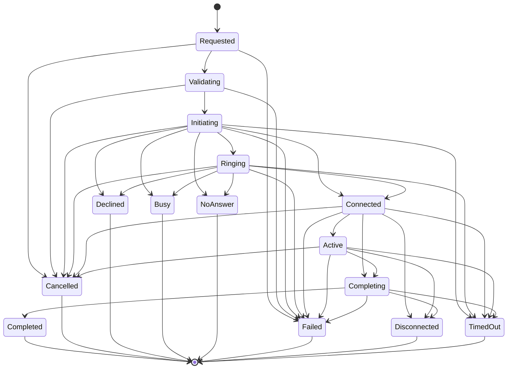

# Canonical call state

Status: implemented in the Rust gateway, contract-tested, not live-provider-verified.

This document is the operational reference for call lifecycle ownership, the
canonical SQLite store, provider mapping, retention, migration, and backup.

## Ownership boundary

```
Recruiter / Python ai-service                 Twilio / Vapi
              │                                   │
              │ Bearer API key                    │ signed webhooks
              ▼                                   ▼
        gateway/src/calls.rs  ◄───────────────────┘
              │
              │ sole application writer
              ▼
        $GATEWAY_CALL_DB_PATH (default data/calls.db)
        calls, call_transitions, call_events,
        unmatched_call_events, call_providers
```

- The gateway is the **only application-level writer** of canonical call state.
- The ai-service owns interviews, transcripts, evidence, and reports in its own
  SQLite database. It must call the gateway API; it must not open or write the
  call database.
- The call database is separate from the interview database. There is no
  cross-database foreign key, no shared transaction, and no dual-writer sync.
- Provider webhooks terminate at the gateway. Gateway authentication and
  provider signature verification happen before state mutation.

## Lifecycle



`Connecting` exists in the domain enum but is not entered by the current
transition table. `path_to()` in the gateway computes the shortest legal path
for a provider target, so a provider can report `in-progress` while the local
call is still `Initiating`; the store applies `Connect` then `Activate` in one
transaction.

Terminal states reject late events. A provider event also carries a monotonic
sequence mapped by the adapter (Twilio: 10/20/30/40/50; Vapi: 5/10/30/40/50).
An event whose sequence is not greater than the last applied sequence is
recorded as ignored and cannot regress the call.

## Gateway API

All routes are on the gateway and use the gateway API key (`Authorization:
Bearer ...` or `?token=`).

| Method | Path | Purpose |
|---|---|---|
| `GET` | `/calls/health` | SQLite `quick_check`, database path, provider count |
| `GET` | `/calls/providers` | Configured providers and adapter capabilities |
| `POST` | `/calls` | Start an outbound call |
| `GET` | `/calls?interview_session_id=<uuid>` | List calls for an interview |
| `GET` | `/calls?interview_session_id=<uuid>&latest=true` | Latest call for an interview |
| `GET` | `/calls?provider_call_id=<id>` | Resolve a provider call ID |
| `GET` | `/calls/by-provider/{provider_call_id}` | Resolve a provider call ID |
| `GET` | `/calls/idempotency/{key}` | Resolve a stored idempotency key |
| `GET` | `/calls/{id}` | Call state and provider link |
| `GET` | `/calls/{id}/transitions` | Ordered transition audit |
| `POST` | `/calls/{id}/end` | Ask the provider to end the call and mark it cancelled |

`POST /calls` accepts:

```json
{
  "provider": "twilio",
  "interview_session_id": "00000000-0000-0000-0000-000000000000",
  "direction": "outbound",
  "transport": "pstn",
  "to": "+15551234567",
  "idempotency_key": "interview-123-attempt-1",
  "requirements": {
    "realtime_audio": true,
    "final_transcripts": true
  }
}
```

Omit `provider` to resolve deterministically from the registry and
requirements. An unsatisfied capability is an error; providers are never
silently downgraded. `GATEWAY_CALLS_ENABLED` must be truthy (`1`, `true`,
`yes`, or `on`) or the call workflow is disabled.

`payload` is used by Vapi. The gateway injects
`metadata.pyinterviewbot_call_id` and `metadata.interview_session_id` without
overwriting other metadata.

## Idempotency and ordering

- `idempotency_key` is unique across the call database. Reuse with a different
  provider or interview is rejected as a conflict.
- Provider call IDs are unique and cannot be linked to two calls.
- `(call_id, provider_event_id)` is the event dedup key. Duplicate events do not
  increment the version or append transitions.
- Events that arrive before the call is linked are stored in
  `unmatched_call_events` by `(provider, provider_call_id, provider_event_id)`.
  On `link_provider_call`, the workflow replays the matching events in receipt
  order inside the same transaction.
- Call updates use optimistic concurrency:
  `UPDATE calls SET ... WHERE id = ? AND version = ?`. A lost update returns
  `ConcurrentModification`.
- Timestamps are UTC Unix milliseconds.

## Provider mapping

The capability matrix describes the **adapter**, not marketing claims about a
vendor.

| Provider | In | Out | Realtime | Messaging | Voice notes | Streaming transcript | Final transcript | Recording | Transfer | Meeting join | Tool calls |
|---|---:|---:|---:|---:|---:|---:|---:|---:|---:|---:|---:|
| Native | no | no | yes | no | no | yes | yes | yes | no | no | no |
| Twilio | yes | yes | yes | yes | yes | no | yes | no | no | no | no |
| Vapi | yes | yes | yes | no | no | yes | yes | no | no | no | yes |
| WhatsApp | no | no | no | yes | yes | no | yes | no | no | no | no |
| Teams | no | no | no | no | no | no | no | no | no | yes | no |

Teams remains scheduling-only (`teamsForBusiness` online meeting creation via
Graph); it does not join meetings or ingest Teams transcripts. WhatsApp live
calling is unsupported/unverified; voice notes are a separate asynchronous
transport.

Twilio status mapping:

| Twilio | Canonical | Sequence |
|---|---|---:|
| `queued`, `initiated` | `Initiating` | 10 / 20 |
| `ringing` | `Ringing` | 30 |
| `in-progress` | `Active` | 40 |
| `completed` | `Completed` | 50 |
| `busy` | `Busy` | 50 |
| `no-answer` | `NoAnswer` | 50 |
| `failed` | `Failed` | 50 |
| `canceled`, `cancelled` | `Cancelled` | 50 |

Vapi mapping:

| Vapi status | Canonical | Sequence |
|---|---|---:|
| `scheduled` | `Initiating` | 5 |
| `queued` | `Initiating` | 10 |
| `ringing` | `Ringing` | 30 |
| `in-progress`, `forwarding` | `Active` | 40 |
| `ended` | terminal classified from `endedReason` | 50 |
| `end-of-call-report` | terminal classified from `endedReason` | 50 |

Vapi ended-reason classification matches `no-answer`, `busy`, `declin`/`reject`,
`cancel`, timeout/max-duration/silence, and error/failed variants. Unknown
reasons map to `Completed`, not success in the interview domain: the ai-service
report remains the place where interview quality is judged.

## Persistence inventory

| Table | Contents | Notes |
|---|---|---|
| `calls` | Current call row, provider link, version, idempotency key, correlation ID | One row per call; unique provider call ID and idempotency key |
| `call_transitions` | Append-only state transitions with sequence and timestamps | Cascades on call deletion |
| `call_events` | Provider event dedup and outcome (`applied`, `ignored`, `duplicate`) | Primary key `(call_id, provider_event_id)` |
| `unmatched_call_events` | Events received before provider-link correlation | Bounded by retention |
| `call_providers` | Provider configuration and capability snapshot | Advisory/operational, not policy truth |

Audio, recordings, transcripts, and media are **not** stored in this database.
The ai-service owns interview transcript/evidence persistence. No call database
row embeds provider credentials.

## Schema migration and rollback

- Schema version is `PRAGMA user_version`; current version is `1`.
- A database newer than the binary is refused (`SchemaTooNew`) instead of being
  modified.
- Future migrations must be additive and transactional. Do not drop or rewrite
  call history in place. Back up before every schema change.
- Rollback of application code is safe for schema v1: older binaries that do not
  know about calls simply do not open this database. Do not downgrade
  `user_version` by hand.
- There is no destructive migration in this change.

## Backup and restore

SQLite is a single-node choice. Do not place the database on a network
filesystem and do not run multiple active gateway writers against one file.

Backup:

```sh
mkdir -p backups
sqlite3 data/calls.db ".backup 'backups/calls-$(date +%Y%m%d-%H%M%S).db'"
sqlite3 backups/calls-YYYYmmdd-HHMMSS.db "PRAGMA quick_check;"
```

To capture WAL state without a running-writer race, use SQLite's online backup
command above or stop the gateway before copying `calls.db`, `calls.db-wal`, and
`calls.db-shm` together.

Restore:

1. Stop the gateway.
2. Preserve the current database files.
3. Restore the backup to `GATEWAY_CALL_DB_PATH`.
4. Ensure only the gateway user can read/write the file and its directory.
5. Start the gateway, then call `GET /calls/health`.

## Retention

Retention is opt-in and does not delete data by default:

- `GATEWAY_CALL_RETENTION_DAYS=<n>` purges terminal calls older than `n` days at
  gateway startup. Child transitions/events cascade.
- `GATEWAY_CALL_UNMATCHED_RETENTION_HOURS=<n>` purges stale unmatched provider
  events at startup.
- `purge_terminal_before` and `purge_unmatched_before` also exist for scheduled
  operations.

Only terminal calls are eligible. Active, ringing, or unmatched-but-recent
calls are not deleted by these paths. A production policy should additionally
delete the ai-service interview record through its audited interview deletion
flow; the two stores are intentionally independent.

## Known gaps

- Live Twilio and Vapi credentials, callback URLs, and account behavior have not
  been validated.
- Inbound Twilio calls are registered canonically, but terminal reconciliation
  depends on a number-level Twilio status callback configuration that is not
  automated or live-verified.
- Vapi tool-call handling is advertised as an adapter capability but is not
  wired into the interview agent end to end.
- The ai-service does not yet call the canonical gateway API for its own
  lifecycle notifications; Python currently receives/creates channel sessions
  through its existing API.
- Multi-replica deployment needs a shared database (Postgres or equivalent) and
  a single-writer/leader design; SQLite is single-node only.
- Call recording/consent policy is provider-specific and not implemented.
