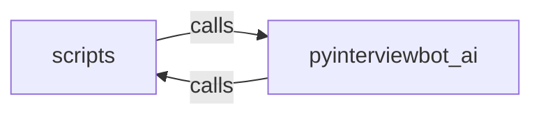

_Generated by CodeAtlas._

## Details

Owns 0 symbols across 4 file(s).

### scripts

Owns 5 symbols across 1 file(s).

**Related Classes/Methods:** _None_

**Source Files:**

- `ai-service/scripts/e2e_ws_test.py`
  - `ai-service.scripts.e2e_ws_test.main`
  - `ai-service.scripts.e2e_ws_test.run`
  - `ai-service.scripts.e2e_ws_test.stream_audio`
  - `ai-service.scripts.e2e_ws_test.synthesize_16k`
  - `ai-service.scripts.e2e_ws_test.trailing_silence`

### pyinterviewbot_ai

Owns 53 symbols across 10 file(s).

**Related Classes/Methods:** _None_

**Source Files:**

- `ai-service/src/pyinterviewbot_ai/agent.py`
  - `ai-service.src.pyinterviewbot_ai.agent._load_graph`
  - `ai-service.src.pyinterviewbot_ai.agent._opening_prompt`
  - `ai-service.src.pyinterviewbot_ai.agent._turn_prompt`
  - `ai-service.src.pyinterviewbot_ai.agent.start_session`
  - `ai-service.src.pyinterviewbot_ai.agent.take_turn`
- `ai-service/src/pyinterviewbot_ai/asr.py`
  - `ai-service.src.pyinterviewbot_ai.asr._get_model`
  - `ai-service.src.pyinterviewbot_ai.asr._pcm16_bytes_to_float32`
  - `ai-service.src.pyinterviewbot_ai.asr._transcribe_sync`
  - `ai-service.src.pyinterviewbot_ai.asr.transcribe`
- `ai-service/src/pyinterviewbot_ai/db.py`
  - `ai-service.src.pyinterviewbot_ai.db._now`
  - `ai-service.src.pyinterviewbot_ai.db.append_transcript`
  - `ai-service.src.pyinterviewbot_ai.db.connect`
  - `ai-service.src.pyinterviewbot_ai.db.create_session`
  - `ai-service.src.pyinterviewbot_ai.db.get_evidence`
  - `ai-service.src.pyinterviewbot_ai.db.get_session_row`
  - `ai-service.src.pyinterviewbot_ai.db.get_transcript`
  - `ai-service.src.pyinterviewbot_ai.db.init_db`
  - `ai-service.src.pyinterviewbot_ai.db.list_sessions`
  - `ai-service.src.pyinterviewbot_ai.db.mark_complete`
  - `ai-service.src.pyinterviewbot_ai.db.record_evidence`
  - `ai-service.src.pyinterviewbot_ai.db.set_turn_count`
- `ai-service/src/pyinterviewbot_ai/evidence.py`
  - `ai-service.src.pyinterviewbot_ai.evidence.EvidenceGraphState`
  - `ai-service.src.pyinterviewbot_ai.evidence.EvidenceGraphState.apply`
  - `ai-service.src.pyinterviewbot_ai.evidence.EvidenceGraphState.sufficiently_covered`
  - `ai-service.src.pyinterviewbot_ai.evidence.EvidenceGraphState.summary_for_prompt`
  - `ai-service.src.pyinterviewbot_ai.evidence.NodeState`
- `ai-service/src/pyinterviewbot_ai/llm.py`
  - `ai-service.src.pyinterviewbot_ai.llm.decide_turn`
- `ai-service/src/pyinterviewbot_ai/main.py`
  - `ai-service.src.pyinterviewbot_ai.main.create_session`
  - `ai-service.src.pyinterviewbot_ai.main.health`
  - `ai-service.src.pyinterviewbot_ai.main.lifespan`
  - `ai-service.src.pyinterviewbot_ai.main.list_sessions`
  - `ai-service.src.pyinterviewbot_ai.main.main`
  - `ai-service.src.pyinterviewbot_ai.main.summary`
  - `ai-service.src.pyinterviewbot_ai.main.synthesize`
  - `ai-service.src.pyinterviewbot_ai.main.transcribe`
  - `ai-service.src.pyinterviewbot_ai.main.turn`
- `ai-service/src/pyinterviewbot_ai/models.py`
  - `ai-service.src.pyinterviewbot_ai.models.AgentTurnDecision`
  - `ai-service.src.pyinterviewbot_ai.models.EvidenceRecord`
  - `ai-service.src.pyinterviewbot_ai.models.EvidenceUpdate`
  - `ai-service.src.pyinterviewbot_ai.models.SessionListItem`
  - `ai-service.src.pyinterviewbot_ai.models.SessionSummary`
  - `ai-service.src.pyinterviewbot_ai.models.StartSessionRequest`
  - `ai-service.src.pyinterviewbot_ai.models.StartSessionResponse`
  - `ai-service.src.pyinterviewbot_ai.models.SynthesizeRequest`
  - `ai-service.src.pyinterviewbot_ai.models.TranscribeResponse`
  - `ai-service.src.pyinterviewbot_ai.models.TranscriptSegment`
  - `ai-service.src.pyinterviewbot_ai.models.TurnRequest`
  - `ai-service.src.pyinterviewbot_ai.models.TurnResponse`
- `ai-service/src/pyinterviewbot_ai/resume.py`
  - `ai-service.src.pyinterviewbot_ai.resume.ResumeClaim`
  - `ai-service.src.pyinterviewbot_ai.resume.seed_claim`
- `ai-service/src/pyinterviewbot_ai/tts.py`
  - `ai-service.src.pyinterviewbot_ai.tts._get_voice`
  - `ai-service.src.pyinterviewbot_ai.tts._synthesize_worker`
  - `ai-service.src.pyinterviewbot_ai.tts.synthesize_stream`
