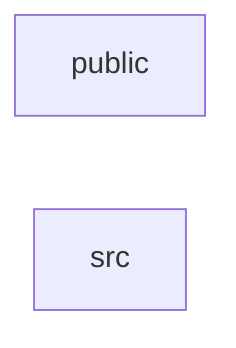

_Generated by CodeAtlas._

## Details

Owns 0 symbols across 4 file(s).

### public

Owns 3 symbols across 3 file(s).

**Related Classes/Methods:** _None_

**Source Files:**

- `candidate-client/public/pcm-worklet.js`
  - `candidate-client.public.pcm-worklet.PcmDownsampleProcessor`
  - `candidate-client.public.pcm-worklet.PcmDownsampleProcessor.constructor`
  - `candidate-client.public.pcm-worklet.PcmDownsampleProcessor.process`

### src

Owns 25 symbols across 6 file(s).

**Related Classes/Methods:** _None_

**Source Files:**

- `candidate-client/src/main.ts`
  - `candidate-client.src.main.renderCandidateView`
  - `candidate-client.src.main.setStatus`
  - `candidate-client.src.main.startInterview`
  - `candidate-client.src.main.tick`
- `candidate-client/src/mic.ts`
  - `candidate-client.src.mic.Mic`
  - `candidate-client.src.mic.Mic.level`
  - `candidate-client.src.mic.Mic.start`
  - `candidate-client.src.mic.Mic.stop`
- `candidate-client/src/player.ts`
  - `candidate-client.src.player.Player`
  - `candidate-client.src.player.Player.constructor`
  - `candidate-client.src.player.Player.enqueue`
  - `candidate-client.src.player.Player.interrupt`
- `candidate-client/src/recruiter.ts`
  - `candidate-client.src.recruiter.EvidenceRecord`
  - `candidate-client.src.recruiter.SessionListItem`
  - `candidate-client.src.recruiter.SessionSummary`
  - `candidate-client.src.recruiter.TranscriptSegment`
  - `candidate-client.src.recruiter.escapeHtml`
  - `candidate-client.src.recruiter.loadSummary`
  - `candidate-client.src.recruiter.renderRecruiterView`
  - `candidate-client.src.recruiter.statusBadge`
- `candidate-client/src/ws-client.ts`
  - `candidate-client.src.ws-client.InterviewSocket`
  - `candidate-client.src.ws-client.InterviewSocket.close`
  - `candidate-client.src.ws-client.InterviewSocket.constructor`
  - `candidate-client.src.ws-client.InterviewSocket.sendAudio`
  - `candidate-client.src.ws-client.WsCallbacks`
