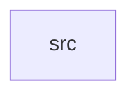

_Generated by CodeAtlas._

## Details

Owns 0 symbols across 1 file(s).

### src

Owns 67 symbols across 6 file(s).

**Related Classes/Methods:** _None_

**Source Files:**

- `gateway/src/ai_client.rs`
  - `gateway.src.ai_client.AiClient`
  - `gateway.src.ai_client.AiClient.agent_turn`
  - `gateway.src.ai_client.AiClient.check_status`
  - `gateway.src.ai_client.AiClient.new`
  - `gateway.src.ai_client.AiClient.start_session`
  - `gateway.src.ai_client.AiClient.synthesize_stream`
  - `gateway.src.ai_client.AiClient.transcribe`
  - `gateway.src.ai_client.AiClient.with_timeout`
  - `gateway.src.ai_client.AiClientError`
  - `gateway.src.ai_client.StartSessionRequest`
  - `gateway.src.ai_client.StartSessionResponse`
  - `gateway.src.ai_client.SynthesizeRequest`
  - `gateway.src.ai_client.TranscribeResponse`
  - `gateway.src.ai_client.TurnRequest`
  - `gateway.src.ai_client.TurnResponse`
  - `gateway.src.ai_client.tests.request_times_out_instead_of_hanging_forever`
- `gateway/src/main.rs`
  - `gateway.src.main.main`
- `gateway/src/session.rs`
  - `gateway.src.session.Session`
  - `gateway.src.session.Session.new`
- `gateway/src/state_machine.rs`
  - `gateway.src.state_machine.Event`
  - `gateway.src.state_machine.IllegalTransition`
  - `gateway.src.state_machine.IllegalTransition.fmt`
  - `gateway.src.state_machine.SessionState`
  - `gateway.src.state_machine.SessionState.fmt`
  - `gateway.src.state_machine.tests.barge_in_from_ai_responding`
  - `gateway.src.state_machine.tests.barge_in_from_ai_speaking`
  - `gateway.src.state_machine.tests.cannot_barge_in_while_listening`
  - `gateway.src.state_machine.tests.cannot_skip_processing_straight_to_responding`
  - `gateway.src.state_machine.tests.completed_state_accepts_no_further_events`
  - `gateway.src.state_machine.tests.error_recovery_can_speak_a_fallback_phrase`
  - `gateway.src.state_machine.tests.error_recovery_returns_to_listening`
  - `gateway.src.state_machine.tests.fault_from_any_active_state_goes_to_error_recovery`
  - `gateway.src.state_machine.tests.happy_path_single_turn`
  - `gateway.src.state_machine.tests.illegal_transition_display_is_readable`
  - `gateway.src.state_machine.tests.interview_completes_after_closing_remark_is_spoken`
  - `gateway.src.state_machine.tests.interview_completes_after_followup_decision`
  - `gateway.src.state_machine.tests.interview_completes_after_processing`
  - `gateway.src.state_machine.tests.pause_and_resume_round_trip`
  - `gateway.src.state_machine.transition`
- `gateway/src/vad.rs`
  - `gateway.src.vad.TurnDetector`
  - `gateway.src.vad.TurnDetector.default`
  - `gateway.src.vad.TurnDetector.observe_frame`
  - `gateway.src.vad.TurnDetector.push_pcm16`
  - `gateway.src.vad.TurnDetector.push_pcm16_capturing`
  - `gateway.src.vad.TurnDetector.reset_turn`
  - `gateway.src.vad.VadEvent`
  - `gateway.src.vad.tests.capturing_stays_empty_until_speech_confirmed`
  - `gateway.src.vad.tests.odd_byte_count_is_buffered_not_dropped`
  - `gateway.src.vad.tests.preroll_ring_is_bounded`
  - `gateway.src.vad.tests.pure_silence_emits_no_events`
  - `gateway.src.vad.tests.reset_turn_clears_counters`
  - `gateway.src.vad.tests.silence_bytes`
- `gateway/src/ws_handler.rs`
  - `gateway.src.ws_handler.AppState`
  - `gateway.src.ws_handler.SpeakOutcome`
  - `gateway.src.ws_handler.TurnOutcome`
  - `gateway.src.ws_handler.apply`
  - `gateway.src.ws_handler.audio_duration`
  - `gateway.src.ws_handler.handle_socket`
  - `gateway.src.ws_handler.listen_for_turn`
  - `gateway.src.ws_handler.router`
  - `gateway.src.ws_handler.send_error`
  - `gateway.src.ws_handler.send_state`
  - `gateway.src.ws_handler.send_state_with_text`
  - `gateway.src.ws_handler.speak`
  - `gateway.src.ws_handler.speak_recovery`
  - `gateway.src.ws_handler.state_label`
  - `gateway.src.ws_handler.ws_upgrade`
