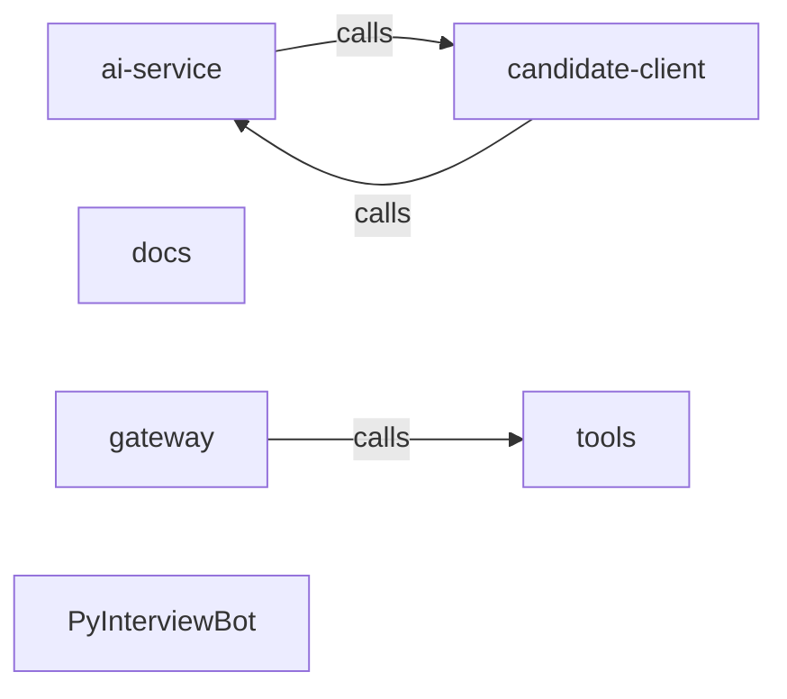

_Generated by CodeAtlas._

## Details

Architecture map of PyInterviewBot.

### ai-service

Owns 0 symbols across 4 file(s).

**Related Classes/Methods:** _None_

### candidate-client

Owns 0 symbols across 4 file(s).

**Related Classes/Methods:** _None_

### docs

Owns 0 symbols across 1 file(s).

**Related Classes/Methods:** _None_

### gateway

Owns 0 symbols across 1 file(s).

**Related Classes/Methods:** _None_

### tools

Owns 0 symbols across 0 file(s).

**Related Classes/Methods:** _None_

### PyInterviewBot

Owns 0 symbols across 10 file(s).

**Related Classes/Methods:** _None_
